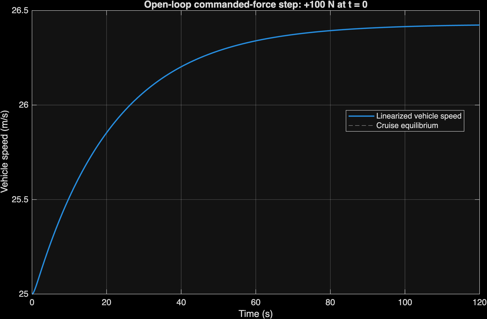
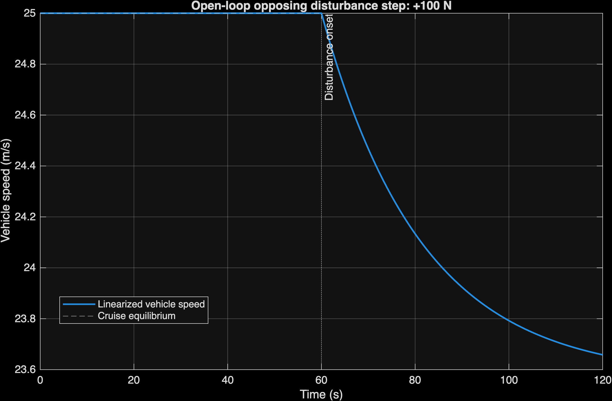
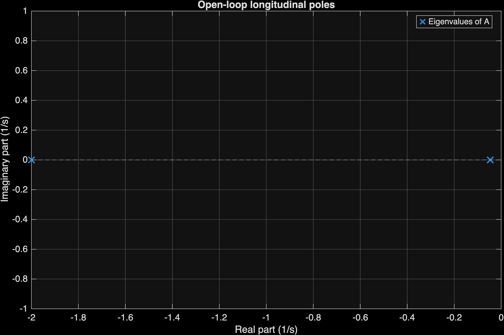

# Modeling and Control of an Autonomous Vehicle Using Cruise Control and 2D Path Tracking

**MAE 506 — Advanced System Modeling, Dynamics and Control**

## Overview

This project investigates mathematical modeling, system analysis, and feedback control for an autonomous vehicle. It combines nonlinear longitudinal dynamics with a 2D kinematic bicycle model to study speed regulation and road following in MATLAB.

State feedback with pole placement and integral action is the primary course-related controller. PID cruise control, a Luenberger observer, and pure-pursuit steering provide additional control and estimation demonstrations. The current speed-control, observer, and steering demonstrations are separate; integrated driving scenarios and moving-car animation remain future work.

## Getting Started

Requirements: **MATLAB R2026b** and **Control System Toolbox**. After cloning or downloading the repository, open MATLAB and set its Current Folder to the repository root.

```matlab
main                         % Run Stages 1–3 and export all twelve plots
vehicle_2d_demo               % Run only the Stage 1 open-loop demonstration
run('tests/smoke_test.m')      % Run main and the numerical/export checks
```

The Stage 1 demo is already included in `main`; its separate command is useful for reviewing that model alone. To run only Stage 3, use:

```matlab
stage3 = stage3_simulations();
```

Full numerical results remain available in `model`, `analysis`, and `stage3` after running `main`.

All PNGs are exported automatically at **300 DPI** under `figures/stage1/`, `figures/stage2/`, and `figures/stage3/`. Figures remain invisible and are closed after export. Rerunning a stage overwrites its corresponding PNGs.

## Project Objectives

- Develop nonlinear longitudinal dynamics, including resistance, aerodynamic drag, and actuator lag, and a 2D kinematic bicycle model.
- Derive cruise equilibria and linearized state-space and transfer-function models.
- Analyze stability, controllability, observability, Gramians, and equivalent canonical forms of the longitudinal SISO model.
- Design speed controllers and automatic steering, then evaluate tracking, disturbance response, and state estimation through MATLAB simulations.
- Extend the implementation to integrated longitudinal and lateral control, vehicle animation, formal controller comparison, and robustness analysis in later stages.

These objectives address the course requirements for physical modeling, system analysis, feedback design, and evaluation of dynamic response and steady-state tracking.

## Implementation Status

| Stage | Status | Scope |
| --- | --- | --- |
| 1 — Vehicle Modeling | Completed | Nonlinear longitudinal and 2D models, cruise equilibrium, Jacobian linearization, reference paths, and open-loop demonstration |
| 2 — System Analysis | Completed | Eigenvalues, stability, controllability, observability, Gramians, canonical forms, transformations, and open-loop responses |
| 3 — Controller Design | Completed | Integral state feedback, PID cruise control, a separate observer demonstration, and straight/curved pure-pursuit tracking |
| 4 — Integrated Simulation and Animation | Planned | Unified speed and steering control, driving scenarios, and moving-car animation |
| 5 — Performance Analysis and Validation | Planned | Controller comparison, response metrics, robustness, and further stability analysis |
| 6 — Final Documentation and Presentation | Planned | Final code review, report, presentation, demonstration, and contribution records |

## System Modeling

### Longitudinal model

```text
m*dv/dt = Fa - b*v - c*v*abs(v) - d
tau*dFa/dt = -Fa + u
```

The two states are speed `v` (m/s) and actual actuator force `Fa` (N). The input `u` is commanded drive/braking force, and `d` is opposing longitudinal disturbance force. Parameters `m`, `b`, `c`, and `tau` represent mass, linear resistance, quadratic drag, and actuator time constant.

| Parameter | Default value |
| --- | --- |
| Vehicle mass, `m` | 1500 kg |
| Linear resistance, `b` | 50 N·s/m |
| Quadratic drag coefficient, `c` | 0.4 N·s²/m² |
| Actuator time constant, `tau` | 0.5 s |

The model is linearized about constant-speed cruising. With `delta_x = x - x_eq`, `delta_u = u - u_eq`, and `delta_y = y - y_eq`, the primary state-space representation is:

```text
delta_x_dot = A*delta_x + B*delta_u
delta_y = C*delta_x + D*delta_u
```

For the cruising speed `v_eq`, the Jacobian matrices are:

```text
A = [-(b + 2*c*abs(v_eq))/m, 1/m;
      0,                    -1/tau]
B = [0; 1/tau]
C = [1, 0]
D = 0
```

An optional disturbance-input term `E*delta_d` can be added to the state equation, where `delta_d = d - d_eq`. Here `E = [-1/m; 0]`, or `[-1/1500; 0]` with defaults, describes how opposing force reduces acceleration. Standard stability, controllability, and observability analysis uses `A`, `B`, `C`, and `D` for this longitudinal linearization; it does not establish those properties for the complete nonlinear 2D vehicle model.

With the default cruising speed of 25 m/s and zero disturbance, the equilibrium actuator and commanded forces are both 1500 N:

```text
G(s) = 1 / (750*s^2 + 1535*s + 70)
```

### 2D kinematic bicycle model

```text
dX/dt = v*cos(psi)
dY/dt = v*sin(psi)
dpsi/dt = (v/L)*tan(delta)

Combined states: [X; Y; psi; v; Fa]
Commanded inputs: [u; delta]
```

`X` and `Y` are global rear-axle coordinates (m), `psi` is heading (rad), `L` is wheelbase (m), and `delta` is the front-wheel steering angle (rad). The five-state model retains the same longitudinal equations. The separate two-state subsystem remains available for SISO cruise-control analysis.

Reference paths include a straight road, `Y = 0`, and a sinusoidal road, `Y = A*sin(2*pi*X/lambda)`, with headings calculated from their slopes. Generating a path does not make the vehicle follow it.

All physical parameters, initial conditions, path settings, and demo inputs are configured in `config.m`. Defaults are illustrative modeling assumptions, not experimentally validated vehicle parameters.

## Control Methods

### State Feedback with Integral Action

The primary course-related controller uses vehicle speed and actuator force to calculate a driving/braking force command. Pole placement assigns the linearized closed-loop dynamics, and integral action corrects remaining steady-state speed error. The controller is applied to the nonlinear longitudinal plant using actual states.

### PID Cruise Control

PID provides an additional practical speed-control approach using proportional, integral, and derivative action. The derivative is calculated from filtered measured speed, avoiding a reference derivative kick. For a fixed speed target, speed change corresponds to the negative rate of error change.

Both cruise controllers include equilibrium/feedforward force, the original actuator lag, ±6000 N command limits, and conditional-integration anti-windup. These illustrative limits correspond to at most 4 m/s² acceleration before resistance at rest. A formal PID-versus-state-feedback comparison under identical scenarios has not yet been completed.

### Luenberger Observer

The observer estimates vehicle speed and actuator force from measured speed and known commanded force using the observable longitudinal linearization. It is demonstrated separately and is not part of the current state-feedback loop.

### Pure-Pursuit Path Tracking

Pure pursuit selects a point ahead on the reference path and calculates steering toward it. It supports straight and sinusoidal roads, with an 8 m lookahead, a 1 m initial lateral offset, and a ±30° steering limit.

The path demonstration maintains a constant 10 m/s forward speed by initializing actuator force at its 540 N equilibrium and holding that command. It stops one lookahead distance before the path endpoint. Speed and steering controllers are not yet integrated. The kinematic model assumes a rear-axle reference point and excludes tire slip, steering actuator lag, sensor noise, and road disturbances.

### Controller Parameters

| Demonstration | Design |
| --- | --- |
| Integral state feedback | Poles `[-0.25, -0.4, -1.5]`, `Kx ≈ [732.633, 0.0516667]`, `Ki = -112.5` |
| PID cruise control | `Kp = 900`, `Ki = 120`, `Kd = 250`, derivative filter time constant 0.1 s |
| Luenberger observer | Poles `[-2.5, -3.5]`, `L ≈ [3.95333; 1125]` |
| Pure pursuit | 8 m lookahead, constant 10 m/s forward speed, 1 m initial lateral offset |

All gains and scenario parameters are defined in `config.m`. Equations and design details are provided in [controller notes](docs/controller_notes.md).

## Simulation Results

### Stage 1 — Vehicle Modeling

With the default configuration, the vehicle starts from rest at `(0, 0)` with zero heading and actuator force. A constant 1500 N command and zero disturbance cause speed to approach 25 m/s gradually; the demo does not impose instantaneous speed tracking. Zero steering keeps the heading at zero and produces a straight trajectory along positive X.

| Plot | What to look for |
| --- | --- |
| [vehicle_trajectory.png](figures/stage1/vehicle_trajectory.png) | Shows the vehicle's X/Y position. Its straight path demonstrates forward motion with zero steering. |
| [vehicle_speed.png](figures/stage1/vehicle_speed.png) | Shows speed over time under constant commanded force. The gradual approach to 25 m/s demonstrates the vehicle and actuator dynamics without feedback control. |
| [vehicle_heading.png](figures/stage1/vehicle_heading.png) | Shows heading over time. Heading stays at zero because the steering command is zero. |

### Stage 2 — System Analysis

Stage 2 demonstrates that the two-state longitudinal deviation model is asymptotically stable, fully controllable, and fully observable around the 25 m/s cruise equilibrium. Canonical coordinate changes preserve the input-output behavior. These conclusions concern the longitudinal subsystem, not the full five-state 2D model or a closed-loop controller.

| Verified result | Value |
| --- | --- |
| Eigenvalues (1/s) | −0.0466667 and −2.0000 |
| Open-loop system | Asymptotically stable |
| Controllability rank | 2/2 |
| Observability rank | 2/2 |
| Controllability and observability Gramians | Both positive definite |
| Minimum controllability Gramian eigenvalue | Approximately `4.547225e-06` |
| Minimum observability Gramian eigenvalue | Approximately `2.652548e-08` |
| Canonical-form transformations | Numerically verified, including transfer-function equivalence |

The following plots are **open-loop responses**, not closed-loop controller results. Speeds are local linear predictions with equilibrium speed added back; asymptotic stability alone does not provide reference tracking or disturbance rejection.

#### Commanded-force response

`force_step_response.png` shows speed over time after a 100 N increase in commanded force at time zero. Speed rises from 25 m/s toward approximately 26.43 m/s, demonstrating the open-loop response to added driving force.



#### Disturbance response

`disturbance_response.png` shows speed after a 100 N opposing disturbance at 60 seconds while commanded force stays at equilibrium. Speed decreases toward approximately 23.57 m/s, showing that this open-loop system does not restore the target speed; these values are steady-state limits rather than exact end-of-plot speeds.



#### Eigenvalue plot

`eigenvalues.png` places the two open-loop eigenvalues in the complex plane. Both lie in the left half-plane, confirming asymptotic stability of the linearized longitudinal model.



### Stage 3 — Controller Design

The following plots show the separate nonlinear cruise-control, observer, and path-tracking demonstrations.

| Plot | What to look for |
| --- | --- |
| [state_feedback_tracking.png](figures/stage3/state_feedback_tracking.png) | Compares desired and actual speed, with commanded force below. It demonstrates speed convergence using state feedback with integral action while respecting the force limits. |
| [pid_speed_tracking.png](figures/stage3/pid_speed_tracking.png) | Compares desired and actual speed as the vehicle accelerates from rest. It demonstrates PID bringing the speed toward the 25 m/s target. |
| [pid_disturbance_rejection.png](figures/stage3/pid_disturbance_rejection.png) | Shows desired and actual speed with the uphill disturbance marked at 60 s. The temporary speed drop and recovery demonstrate PID disturbance rejection. |
| [observer_estimation.png](figures/stage3/observer_estimation.png) | Compares actual and estimated speed and actuator force in two panels. Estimates approach the actual states despite intentionally incorrect initial estimates. |
| [path_tracking.png](figures/stage3/path_tracking.png) | Compares the reference road and actual trajectory, which nearly overlap. The vertical scale is exaggerated for readability so the road curvature is easier to see. |
| [steering_angle.png](figures/stage3/steering_angle.png) | The solid blue line is the commanded steering angle; dashed lines show the ±30° steering limits. The command stays within those limits while guiding the vehicle along the road. |

The PID disturbance test introduces 1500 N opposing force at 60 s. The observer test starts at 24 m/s with actual force 1500 N and initial estimates of 22 m/s and 1000 N; its command stays at equilibrium. Small nonlinear-model mismatch leaves finite-time estimation residuals.

The path-tracking RMS result includes the initial lateral-offset correction over the complete run. Reference and actual trajectories nearly overlap; the normally −10 to +10 m vertical range is visually exaggerated without changing the trajectory or error calculation.

| Result | Value |
| --- | --- |
| State-feedback final speed error | Approximately 0 m/s |
| PID final speed error | Approximately 0 m/s |
| PID final speed error with uphill disturbance | Approximately 0.0001 m/s |
| Observer final speed estimation error | `9.656e-06 m/s` |
| Observer final actuator-force estimation error | `-5.697e-03 N` |
| Curved-path lateral RMS error over the complete run | 0.1467 m |

## Testing and Validation

Stages 1–3 have been implemented and validated locally using MATLAB R2026b. The commands `main`, `vehicle_2d_demo`, and `run('tests/smoke_test.m')` executed successfully, and the smoke test completed without errors.

The existing checks cover:

- **Model consistency:** equilibrium derivatives, matrix dimensions, transfer-function coefficients, finite Stage 1 state histories, and agreement between longitudinal and 2D derivatives at straight cruising equilibrium.
- **System analysis:** expected eigenvalues and ranks, Gramian Lyapunov equations, canonical similarity transformations, transfer-function equivalence, and open-loop responses against analytic solutions.
- **Controller behavior:** finite simulation histories, commanded-force limits, conditional anti-windup during saturation, speed convergence, and PID recovery after the opposing-force disturbance.
- **Estimation and steering:** observer convergence near equilibrium, steering limits, forward motion, constant path speed, and lateral tracking error.
- **Exports and cleanup:** twelve nonempty PNGs in their stage folders, valid README plot links, no obsolete root PNGs, and no remaining figure windows.

Acceptance limits include final-five-second speed errors below 0.05 m/s and overshoot below 10%. Observer errors over 15–20 s must be below 0.001 m/s and 1 N. After the first 30 m, path-error RMS must be below 0.5 m and peak error below 0.75 m. Validation covers these demonstrations and the local linear-model properties; broader nonlinear stability, robustness, and integrated control evaluation remain future work.

Run the smoke test in a fresh MATLAB session or batch mode because it requires no figures to remain open. Failed checks raise an error; successful checks are silent apart from the stage summaries. All twelve linked plots are MATLAB-generated exports.

## Repository Structure

```text
MAE506-Autonomous-Vehicle/
├── README.md
├── .gitignore
├── config.m
├── main.m
├── vehicle_model.m
├── vehicle_2d_model.m
├── reference_path.m
├── vehicle_2d_demo.m
├── system_analysis.m
├── pid_controller.m
├── state_feedback.m
├── observer_controller.m
├── path_tracking_controller.m
├── stage3_simulations.m
├── run_simulations.m
├── compare_results.m
├── tests/
│   └── smoke_test.m
├── figures/
│   ├── .gitkeep
│   ├── stage1/
│   │   ├── vehicle_trajectory.png
│   │   ├── vehicle_speed.png
│   │   └── vehicle_heading.png
│   ├── stage2/
│   │   ├── force_step_response.png
│   │   ├── disturbance_response.png
│   │   └── eigenvalues.png
│   └── stage3/
│       ├── pid_speed_tracking.png
│       ├── pid_disturbance_rejection.png
│       ├── state_feedback_tracking.png
│       ├── observer_estimation.png
│       ├── path_tracking.png
│       └── steering_angle.png
├── docs/
│   ├── model_derivation.md
│   ├── analysis_notes.md
│   ├── controller_notes.md
│   └── results_notes.md
├── report/
│   ├── report_draft.md
│   └── references.txt
└── presentation/
    └── slide_outline.txt
```

| File or folder | Purpose and current status |
| --- | --- |
| `config.m` | Central vehicle, simulation, disturbance, actuator, and reference-path settings |
| `main.m` | Runs completed-stage model checks, Stage 2 analysis, and Stage 3 demonstrations; exports all twelve plots |
| `vehicle_model.m` | Speed and actuator-force equations, cruise equilibrium, and linear state-space/transfer-function models |
| `vehicle_2d_model.m` | Adds position and heading motion to the longitudinal vehicle equations |
| `reference_path.m` | Returns straight and curved path coordinates and headings |
| `vehicle_2d_demo.m` | Runs the open-loop simulation and exports three separate plots at 300 DPI |
| `figures/` | Stage-specific PNG folders; future outputs will use `stage4/` and `stage5/` |
| `system_analysis.m` | Checks stability, controllability, observability, Gramians, and equivalent model forms; exports three plots |
| `pid_controller.m` | Calculates the PID force command with filtering, force limits, and anti-windup |
| `state_feedback.m` | Designs the primary speed controller using pole placement and integral action |
| `observer_controller.m` | Designs the observer that estimates speed and actuator force |
| `path_tracking_controller.m` | Pure-pursuit steering and signed lateral-error calculation |
| `stage3_simulations.m` | Runs the separate controller/observer demonstrations, returns their histories, and exports six plots |
| `run_simulations.m`, `compare_results.m` | Empty placeholders for closed-loop scenarios and comparisons |
| `tests/smoke_test.m` | Checks Stages 1–3, saturation, anti-windup, tracking, observer error, path error, plot paths, and figure closure |
| `docs/controller_notes.md` | Controller equations, gains, assumptions, tuning evidence, and validation limits |
| Other `docs/` files, `report/`, `presentation/` | Empty placeholders for collaborative documentation |
| `.gitignore` | Excludes MATLAB temporary files and macOS metadata; source files and simulation PNGs remain included |

## Future Work

### Stage 4 — Integrated Simulation and Animation

- Integrate longitudinal speed control and lateral steering in one nonlinear 2D simulation.
- Simulate straight and curved roads with reference-speed changes and disturbances.
- Create a moving-car animation and integrated simulation visualizations.

### Stage 5 — Performance Analysis and Validation

- Compare PID and state feedback under consistent scenarios.
- Evaluate rise time, settling time, overshoot, steady-state error, and control effort.
- Test robustness to changes in vehicle mass and drag.
- Consider Lyapunov stability analysis where appropriate.

### Stage 6 — Final Documentation and Presentation

- Complete the final MATLAB code review and technical report.
- Prepare the presentation and project demonstration.
- Finalize documentation, references, figures, and contribution records.

## Team and Contributions

The project is developed by four students. The following table defines **planned assignments across the full project**, including future work; it is not a verified record of historical contributions.

| Team Member | Technical Responsibilities | Final Report Responsibilities | Presentation Responsibilities |
| --- | --- | --- | --- |
| Abbhijit Venkatachalam | Longitudinal and 2D vehicle modeling; equilibrium and linearization; integrated speed and steering simulation; integration testing | Introduction; system modeling; mathematical equations and assumptions | Project overview; vehicle modeling; mathematical model explanation |
| Logan Deison | Stability analysis; controllability and observability; Gramians and canonical forms; mathematical verification; robustness analysis | System analysis; stability and validation results | System analysis; stability, controllability, and observability; mathematical results |
| Tyler Winter | PID and state-feedback controllers; pole placement and integral action; controller tuning; performance comparisons | Controller design; performance evaluation | Controller design; PID and state-feedback methods; performance comparison results |
| Ankit Dhara | Pure-pursuit steering; reference-path generation; Luenberger observer; moving-car animation; simulation visualization | Simulation results; discussion; conclusions | Path tracking; vehicle animation; simulation results and conclusions |

All four members share MATLAB coding and implementation, debugging and testing, technical documentation, review of the complete report, preparation of the final presentation, and review of the final deliverables.

The planned workload is approximately equal, with each member contributing about 25% overall and preparing and presenting approximately one-quarter of the presentation. Final-report writing should also be balanced across the four members. Responsibilities involving integration, animation, robustness, or final deliverables remain planned until those tasks are completed.
