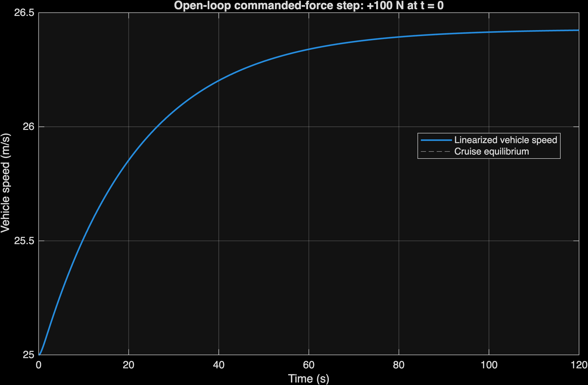
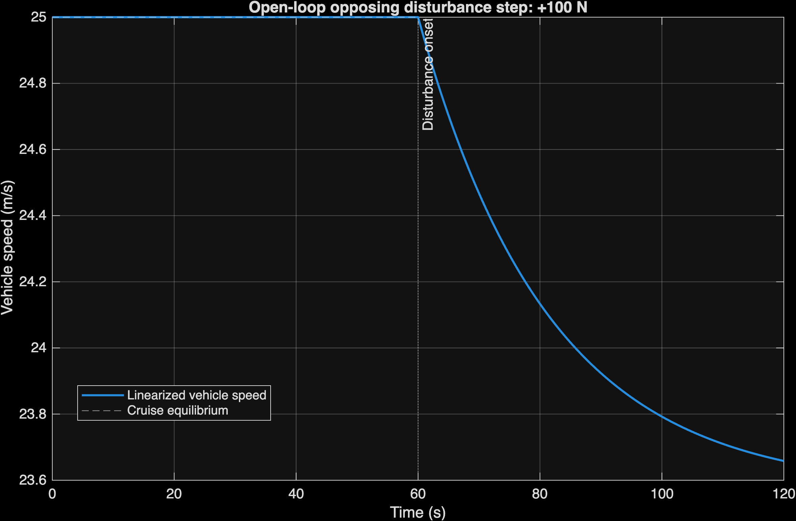
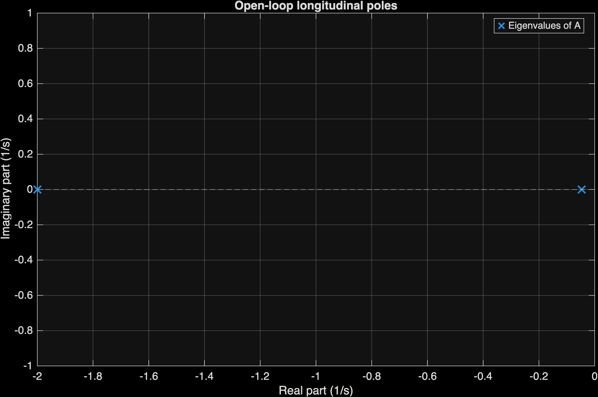

# Modeling and Control of an Autonomous Vehicle Using Cruise Control and 2D Path Tracking

MAE 506: Advanced System Modeling, Dynamics and Control

## Project overview

This project combines mathematical modeling, system analysis, and feedback control of a vehicle in MATLAB. The final goal is to maintain vehicle speed while following straight and curved roads, evaluate stability and system properties, and compare controller performance.

The project includes nonlinear longitudinal dynamics and a 2D kinematic bicycle model. Planned extensions include cruise control, steering and path tracking, PID and state-feedback control, closed-loop simulations, and vehicle animation.

**Current work:** Stages 1 and 2 are completed and locally tested. The 2D demo uses constant commanded force and zero steering to demonstrate straight-line motion. Stage 2 analyzes the linearized longitudinal subsystem and its open-loop responses. Closed-loop speed control and path tracking are not implemented; Stage 3 controller design remains planned.

## Mathematical models

### Longitudinal model

```text
m*dv/dt = Fa - b*v - c*v*abs(v) - d
tau*dFa/dt = -Fa + u
```

The two states are speed `v` (m/s) and actual actuator force `Fa` (N). The input `u` is commanded drive/braking force, and `d` is opposing longitudinal disturbance force. Parameters `m`, `b`, `c`, and `tau` represent mass, linear resistance, quadratic drag, and actuator time constant.

The model is linearized about constant-speed cruising. Its state-space matrices describe deviations from the equilibrium, with `E` representing disturbance input. With the default cruising speed of 25 m/s and zero disturbance, the equilibrium actuator and commanded forces are both 1500 N:

```text
G(s) = 1 / (750*s^2 + 1535*s + 70)
```

### 2D kinematic bicycle model

```text
dX/dt = v*cos(psi)
dY/dt = v*sin(psi)
dpsi/dt = (v/L)*tan(delta)

Combined states: [X; Y; psi; v; Fa]
Commanded inputs: [u; delta]
```

`X` and `Y` are global rear-axle coordinates (m), `psi` is heading (rad), `L` is wheelbase (m), and `delta` is the front-wheel steering angle (rad). The five-state model retains the same longitudinal equations. The separate two-state subsystem remains available for SISO cruise-control analysis.

Reference paths include a straight road, `Y = 0`, and a sinusoidal road, `Y = A*sin(2*pi*X/lambda)`, with headings calculated from their slopes. Generating a path does not make the vehicle follow it.

All physical parameters, initial conditions, path settings, and demo inputs are configured in `config.m`. Defaults are illustrative modeling assumptions, not experimentally validated vehicle parameters.

## Stage progress

| Stage | Purpose | Status | Implementation details |
| --- | --- | --- | --- |
| 1 — Vehicle Modeling and Linearization | Establish and verify the physical models | Completed and locally tested | Nonlinear models, equilibrium, Jacobian, state-space and transfer-function models, reference paths, open-loop demo, plots, and validation checks |
| 2 — System Analysis | Evaluate system properties | Completed and locally tested | Eigenvalues, stability, controllability, observability, Gramians, canonical forms, coordinate transformations, and open-loop responses |
| 3 — Controller Design | Design speed and steering feedback | Planned | `pid_controller.m` and `state_feedback.m` are placeholders; observer and steering control are planned |
| 4 — Closed-Loop Simulations | Test integrated control scenarios | Planned | `run_simulations.m` is a placeholder; the existing open-loop demo belongs to Stage 1 |
| 5 — Performance Analysis and Validation | Evaluate and compare control methods | Planned | `compare_results.m` is a placeholder |
| 6 — Final Documentation and Presentation | Prepare final deliverables | Planned | Report, notes, references, and presentation files are placeholders |

The project team reports successful local testing of Stages 1 and 2, including the MATLAB smoke test without reported errors. All six PNG plots have been generated and reviewed. Stages 3–6 remain planned and are not implemented.

### Stage 1 — Vehicle Modeling and Linearization

- [x] Nonlinear longitudinal dynamics with aerodynamic drag and actuator dynamics
- [x] Equilibrium calculations and Jacobian linearization
- [x] State-space matrices `A`, `B`, `C`, `D`, `E` and transfer-function derivation
- [x] Five-state 2D kinematic bicycle model
- [x] Straight and sinusoidal reference paths with reference headings
- [x] Open-loop simulation using `ode45`
- [x] Vehicle trajectory, speed, and heading plots saved as PNG files
- [x] Local MATLAB validation, with silent checks in `main.m`

### Stage 2 — System Analysis

- [x] Eigenvalues and stability analysis
- [x] Controllability and observability rank tests and Gramians
- [x] Controllable and observable canonical forms
- [x] Numerically verified coordinate transformations and transfer-function equivalence
- [x] Open-loop response analysis and three exported plots
- [x] MATLAB smoke test completed without reported errors

### Stage 3 — Controller Design

- [ ] PID cruise controller
- [ ] State-feedback controller using pole placement
- [ ] Integral action for steady-state tracking
- [ ] Luenberger state observer
- [ ] Steering and path-tracking controller

### Stage 4 — Closed-Loop Simulations

- [ ] Speed tracking and reference-speed changes
- [ ] Straight-road and curved-road tracking
- [ ] Uphill disturbance rejection
- [ ] Integrated speed and steering control
- [ ] Closed-loop MATLAB plots and vehicle animation

### Stage 5 — Performance Analysis and Validation

- [ ] Lyapunov stability analysis
- [ ] Rise time, settling time, and overshoot
- [ ] Steady-state tracking error and control effort
- [ ] Robustness testing with varying vehicle mass and drag
- [ ] PID versus state-feedback comparison

### Stage 6 — Final Documentation and Presentation

- [ ] Final MATLAB code review
- [ ] Technical report and references
- [ ] Final simulation figures and results
- [ ] Project presentation
- [ ] Team-member contributions
- [ ] Final README updates

## Project files

```text
MAE506-Autonomous-Vehicle/
├── README.md
├── .gitignore
├── config.m
├── main.m
├── vehicle_model.m
├── vehicle_2d_model.m
├── reference_path.m
├── vehicle_2d_demo.m
├── system_analysis.m
├── pid_controller.m
├── state_feedback.m
├── run_simulations.m
├── compare_results.m
├── tests/
│   └── smoke_test.m
├── figures/
│   ├── .gitkeep
│   ├── vehicle_trajectory.png
│   ├── vehicle_speed.png
│   ├── vehicle_heading.png
│   ├── stage2_force_step_response.png
│   ├── stage2_disturbance_response.png
│   └── stage2_eigenvalues.png
├── docs/
│   ├── model_derivation.md
│   ├── analysis_notes.md
│   ├── controller_notes.md
│   └── results_notes.md
├── report/
│   ├── report_draft.md
│   └── references.txt
└── presentation/
    └── slide_outline.txt
```

| File or folder | Purpose and current status |
| --- | --- |
| `config.m` | Central vehicle, simulation, disturbance, actuator, and reference-path settings |
| `main.m` | Displays Stage 1 model information, runs silent model checks, and calls Stage 2 analysis |
| `vehicle_model.m` | Two-state nonlinear cruise model, equilibrium, linearization, and Control System Toolbox models |
| `vehicle_2d_model.m` | Five-state nonlinear bicycle dynamics with input validation |
| `reference_path.m` | Returns straight and curved path coordinates and headings |
| `vehicle_2d_demo.m` | Runs the open-loop simulation and exports three separate plots at 300 DPI |
| `figures/` | Generated simulation PNG files; `.gitkeep` preserves the folder |
| `system_analysis.m` | Analyzes the longitudinal deviation model, verifies Gramians and canonical forms, returns full numerical results, and exports three open-loop plots |
| `pid_controller.m`, `state_feedback.m` | Empty placeholders for controller design |
| `run_simulations.m`, `compare_results.m` | Empty placeholders for closed-loop scenarios and comparisons |
| `tests/smoke_test.m` | Runs model checks and verifies poles, ranks, Lyapunov residuals, analytic step responses, and plot files |
| `docs/`, `report/`, `presentation/` | Existing files are empty placeholders for collaborative documentation |
| `.gitignore` | Excludes MATLAB temporary files and macOS metadata; source files and simulation PNGs remain included |

## How to run

Requirements: MATLAB (developed with R2026b) and Control System Toolbox.

All plots are saved directly to `figures/` at 300 DPI without figure windows or popups. Figures are created invisibly and closed after successful export. Rerunning a script overwrites its corresponding PNG files.

1. Open the repository folder in MATLAB and set it as the Current Folder.
2. Run the model summary and validation checks:

   ```matlab
   main
   ```

   This displays the Stage 1 model summary followed by concise Stage 2 results and exports the three Stage 2 plots. Numerical checks are silent when successful and raise errors on failure. Full matrices, Gramians, canonical forms, transformations, and verification errors remain available in the `model` and `analysis` structures.

3. Run the separate open-loop demonstration:

   ```matlab
   vehicle_2d_demo
   ```

   This simulates the vehicle with `ode45` and saves trajectory, speed, and heading PNGs in `figures/` without displaying plot windows. Running `main` does not launch the demo.

4. Run the smoke test:

   ```matlab
   run('tests/smoke_test.m')
   ```

   This runs `main` and the focused numerical checks, regenerating the Stage 2 plots.

## Current simulation results

With the default configuration, the vehicle starts from rest at `(0, 0)` with zero heading and actuator force. A constant 1500 N command and zero disturbance cause speed to approach 25 m/s gradually; the demo does not impose instantaneous speed tracking. Zero steering keeps the heading at zero and produces a straight trajectory along positive X.

The generated plots are:

- [Vehicle trajectory](figures/vehicle_trajectory.png)
- [Vehicle speed](figures/vehicle_speed.png)
- [Vehicle heading](figures/vehicle_heading.png)

The current 2D demonstration shows straight-line motion because steering is zero. The curved reference path is available, but curved-road tracking, PID control, and state-feedback control are not implemented. Steering and path-tracking controllers are planned for Stage 3; integrated road-following simulations and moving-car animation are planned for Stage 4. The existing PNGs are static plots, not vehicle animation.

## Stage 2 — System Analysis Results

Stage 2 demonstrates that the two-state longitudinal deviation model is asymptotically stable, fully controllable, and fully observable around the 25 m/s cruise equilibrium. Canonical coordinate changes preserve the input-output behavior. These conclusions concern the longitudinal subsystem, not the full five-state 2D model or a closed-loop controller.

| Verified result | Value |
| --- | --- |
| Eigenvalues (1/s) | −0.0466667 and −2.0000 |
| Open-loop system | Asymptotically stable |
| Controllability rank | 2/2 |
| Observability rank | 2/2 |
| Controllability and observability Gramians | Both positive definite |
| Minimum controllability Gramian eigenvalue | Approximately `4.547225e-06` |
| Minimum observability Gramian eigenvalue | Approximately `2.652548e-08` |
| Canonical-form transformations | Numerically verified, including transfer-function equivalence |
| MATLAB smoke test | Completed locally without reported errors, as reported by the team |

The following plots are **open-loop responses**, not closed-loop controller results. Speeds are local linear predictions with equilibrium speed added back; asymptotic stability alone does not provide reference tracking or disturbance rejection.

### Commanded-force response

A 100 N increase in commanded force at time zero causes vehicle speed to rise from 25 m/s toward approximately 26.43 m/s.



### Disturbance response

A 100 N opposing disturbance introduced at 60 seconds, with commanded force held at equilibrium, causes vehicle speed to decrease toward approximately 23.57 m/s. These values are steady-state limits rather than exact speeds at the end of the plotted interval.



### Eigenvalue plot

Both eigenvalues lie in the left half-plane, confirming asymptotic stability of the linearized open-loop longitudinal model.



## Final project goals

- Autonomous speed regulation and 2D road following
- Stability, controllability, and observability analysis
- PID versus state-feedback control and performance comparison
- Disturbance rejection and robustness testing
- Integrated MATLAB simulations and vehicle animation

## Team collaboration

This project is being developed collaboratively by a team of four members. The team is responsible for vehicle modeling, system analysis, controller design, MATLAB simulations, testing, and documentation.The repository tracks our implementation and progress throughout the project. Individual contributions will be documented in the final project report and README.
